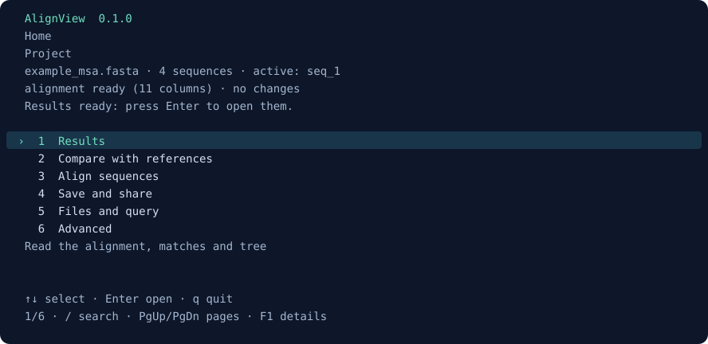

# AlignView

**Explorer des séquences, construire des alignements et partager des résultats compréhensibles.**

Application terminal pour Linux et SSH/HPC, Python 3.10+, sans dépendance Python obligatoire. Version locale : **0.1.0**. Le rapport HTML est autonome ; les figures sont exportables en SVG.

## Lancer l’application

Tout le nécessaire à l’application est dans ce dossier **`AlignView/`**. On peut le copier entier. Pour garder les résultats à côté de ses données, lancer depuis son dossier de travail :

```bash
cd /chemin/vers/mes_donnees
/chemin/vers/AlignView/alignview.sh --demo
/chemin/vers/AlignView/alignview.sh
```

Depuis l’intérieur d’`AlignView/`, utiliser `./alignview.sh`. La démonstration ne nécessite aucun moteur externe. Le lanceur conserve le dossier courant : les chemins relatifs des entrées et des sorties partent de ce dossier.

**Premier usage : [suivre les premiers pas](docs/QUICKSTART.md).** Tous les guides sont dans [l’index de documentation](docs/README.md).

```bash
./alignview.sh --docs                 # choisir un guide depuis l’index
./alignview.sh --docs demarrage       # les premiers pas
./alignview.sh --docs fichiers        # où vont les résultats ?
./alignview.sh --docs depannage       # résoudre un problème
```

L’aide est disponible au démarrage avec **Lire la documentation**, ou dans **Réglages et aide → Documentation complète**. Elle est aussi embarquée dans le wheel et le `.pyz`.



## Trouver une fonction

| Rubrique | Fonctions principales |
| --- | --- |
| **1 · Explorer** | Visionneuse MSA, séquences, qualité, HSP, couvertures, conservation, distances, arbre |
| **2 · Analyser** | Recherches BLAST/DIAMOND/MMseqs2, MSA, Needle/Water, motifs, traduction, ORF, profils, dotplot |
| **3 · Données** | Séquence active, changement de fichiers, historique et reprise de projet |
| **4 · Enregistrer et partager** | Projet portable, HTML, tables, alignements, SVG et script Slurm |
| **5 · Réglages et aide** | Moteurs, paramètres, profils JSON, provenance et documentation complète |

Les prérequis des choix indisponibles sont expliqués. **Échap / ←** revient d’un niveau ; **F2** revient à l’accueil ; **F1** explique le choix sélectionné ; `/` recherche dans les listes. Les numéros se valident avec Entrée. La visionneuse conserve sa position et dispose de sa propre aide `?`.

Une recherche de similarités détecte des segments locaux ; un MSA compare des colonnes de séquences supposées homologues. Ces deux étapes répondent à des questions différentes. Le [guide de toutes les fonctions](docs/USAGE.md) décrit les entrées, les actions et l’interprétation de chaque parcours.

## Conserver les résultats au bon endroit

Les calculs restent temporaires tant qu’une sauvegarde ou un export n’est pas demandé.

| Besoin | Option ou action | Résultat |
| --- | --- | --- |
| Reprendre plus tard | `--save --out resultats/projet_01` | Projet complet, relatif au dossier de lancement |
| Garder seulement la présentation | `--html-out rapport.html` | HTML autonome, sans projet de reprise |
| Réutiliser des données | `--export-profile publication --export-dir exports_01` | Tables, alignements, HTML et SVG selon les données |
| Préparer le HTML dans un projet | `--report --save --out projet_01` | `projet_01/report.html` et résultats associés |

`--out` seul ne sauvegarde pas ; `--report` seul prépare un HTML temporaire. Une destination existante est refusée en batch. Sans `--out`, `--save` crée un dossier daté dans le dossier de lancement. Les [règles de fichiers](docs/FILES.md) détaillent le comportement, les temporaires et la récupération.

Les commandes suivantes supposent la commande `alignview` installée ; sans installation, la remplacer par `/chemin/vers/AlignView/alignview.sh` :

```bash
# Lire sans lancer de moteur et conserver un HTML.
alignview aligne.fasta --msa view --html-out rapport.html --no-menu

# Aligner, puis garder toutes les données dans un projet.
alignview sequences.fasta --msa align --report --save --out resultats/msa_01 --no-menu

# Chercher une requête ADN contre des références protéiques.
alignview requete.fna references.faa --mode blastx --msa hits --report --save --out resultats/recherche_01 --no-menu

# Arbre et figure à partir d’un alignement existant.
alignview aligne.fasta --msa view --tree --report --save --out resultats/arbre_01 --no-menu

# Reprendre sans recalcul, ou reconstruire seulement le HTML.
alignview --resume resultats/arbre_01
alignview --resume resultats/arbre_01 --html-out actualise.html --no-menu
```

## HTML, figures et arbre

Le HTML s’ouvre dans un navigateur après la fermeture d’AlignView et peut être partagé seul. Il propose un résumé guidé, les correspondances, les séquences, le MSA, le dotplot, l’atlas de figures, les exports et la provenance selon les données disponibles.

Après un calcul FastTree, **Voir l’arbre** ouvre sa figure avec identifiants, branches, supports et échelle. **Télécharger SVG** conserve une figure vectorielle. Les fichiers sont aussi dans `figures/45_arbre_fasttree.svg` et `tree_fasttree.nwk`. La racine de dessin est arbitraire ; les supports locaux SH-like ne sont pas des bootstraps.

Le [guide du HTML](docs/HTML.md) explique les vues et les limites de données intégrées. Les exports applicatifs complets sont décrits dans [Formats et coordonnées](docs/EXPORTS.md).

## Moteurs et paramètres

La lecture, la visualisation et les analyses internes fonctionnent sans moteur externe. MAFFT/MUSCLE/Clustal Omega créent les MSA ; BLAST/DIAMOND/MMseqs2 effectuent les recherches ; EMBOSS compare deux séquences ; FastTree calcule un arbre.

```bash
./alignview.sh --diagnose
./alignview.sh --setup minimal                    # afficher le plan
./alignview.sh --setup minimal --install-tools    # exécuter avec Conda/Mamba/Micromamba
```

L’installation des moteurs est facultative et peut utiliser un environnement dédié, les programmes existants ou les modules HPC. Pour les regrouper dans `AlignView/tools/`, suivre [l’installation locale](docs/INSTALLATION.md). Le téléchargement des moteurs n’est pas nécessaire pour lire les exemples.

Avant chaque calcul : **Paramètres de calcul / Paramètres du moteur**, **F1** pour comprendre l’effet, **Voir les commandes** pour inspecter les arguments. Les profils JSON réutilisent les réglages. Les paramètres d’un résultat déjà calculé restent conservés dans la provenance, même si les réglages futurs changent.

Une nouvelle recherche conserve jusqu’à **100 références** par défaut. Les profils de seuil Standard/Plus permissif/Plus strict ne changent pas ce maximum. `--hits 200` l’augmente explicitement ; une reprise conserve les réglages enregistrés sauf option explicite.

## Documentation complète

[Premiers pas](docs/QUICKSTART.md) · [Tous les parcours](docs/USAGE.md) · [Dossiers et sauvegardes](docs/FILES.md) · [Installation](docs/INSTALLATION.md) · [Paramètres](docs/PARAMETERS.md) · [HTML et figures](docs/HTML.md) · [Exports](docs/EXPORTS.md) · [CLI complète](docs/CLI.md) · [Dépannage](docs/TROUBLESHOOTING.md) · [Glossaire](docs/GLOSSARY.md).

[Développement](docs/DEVELOPMENT.md) · [Publication](docs/RELEASING.md) · [Audit et limites](docs/AUDIT.md) · [Contribuer](CONTRIBUTING.md) · [Licence MIT](LICENSE).

Les FASTA et MSA sont chargés en mémoire. L’import interactif est FASTA/FASTA gzip ; les autres formats annoncés sont des exports. Les arbres et ORF sont exploratoires ; les traductions utilisent le code standard. Les distributions sont préparées localement, sans publication PyPI/Bioconda revendiquée. La validation locale ne remplace pas les essais sur le cluster et les données réellement utilisés.
