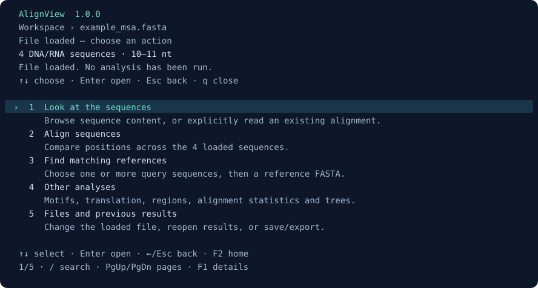

# AlignView 1.0

**Load sequences, choose any analysis, and return to every earlier result.**

AlignView is a terminal workspace for Linux and SSH, with an offline HTML companion. Data and Results stay accessible throughout the session, with dedicated readers for alignments, matches, trees and sequence analyses. You can select references from the evidence table, trace an alignment against a chosen sequence, export a region, and keep the exact calculation settings that produced the result.

Python 3.10+ is required. The application uses only the standard library; scientific executables are optional and needed only for the calculation you choose. The application, source and single bundled manual use English.

## Start with a task

```bash
/path/to/AlignView/alignview.sh --demo
/path/to/AlignView/alignview.sh view aligned.fasta
/path/to/AlignView/alignview.sh align sequences.fasta
/path/to/AlignView/alignview.sh compare queries.fna references.faa
/path/to/AlignView/alignview.sh report my_project --html-out study.html
```

Without arguments, choose **Load sequences**, **Open a saved project**, or the demo. Opening a bare FASTA displays its name, sequence count/type and a short action menu. It does not open a sequence table or alignment reader automatically. No goal selection, fixed route or project save is required. Equal-length sequences are not silently declared aligned. The demo needs no external engine.

Keep the complete application in one `AlignView/` folder and launch from your data directory. The launcher preserves the caller's directory; relative inputs and outputs belong there.

## Explore freely

After loading, choose one of five explained actions: **Look at the sequences**, **Align sequences**, **Find matching sequences**, **Other analyses**, or **Files and previous results**. The file menu is your starting point whenever you want to do something else. No goal selection or keyboard-command knowledge is required.

An analysis first shows its preparation screen. Run starts it; Esc cancels and returns to the same file menu. A completed calculation opens a **result-ready summary**, where you can open the result, try different settings, return to file actions or revisit an earlier result. Tables and readers open only after you choose them. Explicit CLI tasks such as `view` still perform the task you requested.

Every completed interactive analysis receives its own temporary snapshot. Run another alignment or change search filters: the previous alignment and its tree remain in Results. Opening a result does not rerun its engine. Its recorded input links identify the dataset or alignment used. Translation, extracted-region, ORF and alignment outputs can be reused through **Use result as sequence data**.

**Esc** returns to the preceding view with its filter, cursor and reading position retained. **Enter** opens the highlighted item. **:** or **Ctrl+P** finds every command; **w** previews HTML without asking for an export destination. Menus accept arrow keys, Enter or mouse clicks. In the file menu, q closes; Esc goes back when a preceding context exists. Saving is optional and is only needed to retain the workspace after closing.



**Find matching sequences** first lets you check one or several query sequences from the FASTA. Space checks a row, a selects all, c clears and / finds an identifier; Enter confirms. Choose the reference data, review the scope and Run. Multiple queries produce a grouped result with one independent comparison per query, retaining its own coverage, identity and references. Previous results shows the group; Open this result lets you choose its query results.

A comparison shows its selected queries, inputs and engine before execution. Multi-query FASTA input requires an explicit choice. Search evidence keeps local HSP identity and union coverage distinct; VSEARCH retains its own global metrics. Selecting references changes alignment scope without pretending to change the original search.

## Save, share or reuse

| Need | Action or option |
| --- | --- |
| Continue calculations later | Save project / `--save --out project_01` |
| Share a browser exploration | Share HTML / `--html-out study.html` |
| Reuse specific results | Export FASTA, evidence TSV, tree SVG or a result folder |

```bash
# View an existing alignment; retain one standalone report.
./alignview.sh report aligned.fasta --html-out study.html

# Build and save an alignment in batch.
./alignview.sh align sequences.fasta --no-menu --save --out project_01

# Compare a chosen nucleotide query with protein references.
./alignview.sh compare queries.fna references.faa --query-id query_2 \
  --mode blastx --no-menu --save --out comparison_01

# Resume without rerunning old calculations.
./alignview.sh resume project_01

# Rebuild a project's HTML snapshot without scientific engines.
./alignview.sh report project_01 --html-out updated.html
```

Batch output destinations are refused when they already exist. Interactive HTML sharing asks before replacing a report. `--out` alone does not save; `--report` alone prepares temporary HTML. A project includes input copies, available results, history and provenance. HTML is a standalone snapshot containing its data, scripts, styles and SVG figures; no server, CDN or Internet connection is required to read it.

In Matches, **View aligned regions** shows the query/target IDs, native positions and aligned letters for each local segment. The browser report highlights the selected segment, labels the coordinates of each displayed page and can download both complete aligned rows. Empty engine results are explained separately from matches excluded by filters.

`--no-menu` also disables readers and save prompts when run in an interactive terminal. The `report` task writes its HTML and exits. Projects are retained only when explicitly saved or exported.

## Scientific tools and limits

Supported engines include BLAST, DIAMOND, MMseqs2, MAFFT, MUSCLE 5, Clustal Omega, EMBOSS Needle/Water, FastTree and VSEARCH. Inspect their paths and versions with `alignview tools`. Missing engines have an explicit setup plan:

```bash
./alignview.sh tools
./alignview.sh tools --setup mafft
./alignview.sh tools --setup mafft --install-tools
```

A local `tools/` environment, loaded HPC modules, executable directories and explicit executable paths are supported. The application does not bundle scientific binaries or submit Slurm jobs automatically.

The bundled `examples/demo_query.fna` / `examples/demo_references.faa` provide a synthetic query-to-reference example in [Getting started](docs/QUICKSTART.md).

The 27 bundled NCBI translation tables require a biological choice; the simple ORF detector is not a gene predictor. FastTree needs at least three aligned sequences. Its drawing root is arbitrary and local SH-like support is not bootstrap support. Local search identity is not whole-sequence identity, and uncovered regions do not prove non-homology. See the [release contract](docs/RELEASE_CONTRACT.md) and [validation scope](docs/AUDIT.md).

## Documentation and development

Bioconda packaging is prepared locally in [packaging/bioconda](packaging/bioconda/README.md), with a verified-source recipe generator and [submission handoff](packaging/bioconda/SUBMISSION.md). This does not mean the package is already available on Bioconda.

`alignview --help` explains the common tasks; `--help-all` lists all engine options. `alignview --docs` opens the offline manual before any dataset is loaded.

[Getting started](docs/QUICKSTART.md) · [Usage](docs/USAGE.md) · [Files](docs/FILES.md) · [Installation](docs/INSTALLATION.md) · [Parameters](docs/PARAMETERS.md) · [HTML](docs/HTML.md) · [VSEARCH](docs/VSEARCH.md) · [Genetic codes](docs/GENETIC_CODES.md) · [CLI](docs/CLI.md).

```bash
python3 -m unittest discover -s tests -v
python3 scripts/generate_cli_docs.py --check
python3 scripts/check_docs.py
python3 scripts/build_release.py
```

See [Design review and comparison](docs/DESIGN_REVIEW.md), [Development](docs/DEVELOPMENT.md), [Contributing](CONTRIBUTING.md) and [Releasing](docs/RELEASING.md). Local checks establish the tested behavior, not a biological accuracy ranking or universal cluster compatibility.
