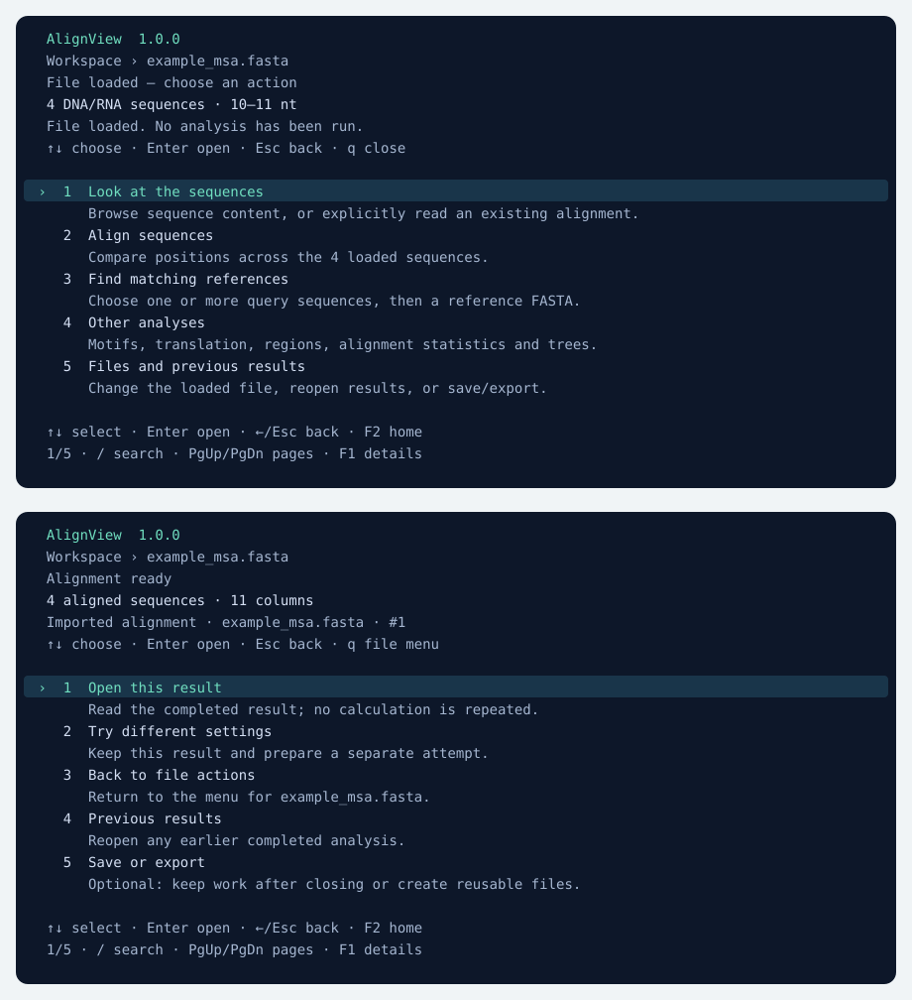

# Proposal: load sequences, explore freely, retain every result

Status: historical design proposal, 13 November 2026. The core data/result catalog, independent attempts, Back navigation, output reuse and optional saving have since been implemented. Archive/Undo, failed-attempt catalog entries and concurrent execution remain proposals. See [Free exploration](WORKFLOWS.md) for current behavior and [Interface review](UX_REVIEW.md) for implementation limits. UI labels remain English.

## Product decision

Make AlignView a sequence workbench: load nucleotide or protein sequences, inspect them immediately, select an analysis when useful, and keep each result available for further work. A project contains several datasets and several results. It does not have one global scientific goal, query, reference database or current alignment.

Keep guidance through relevant actions, plain explanations and explicit prerequisites. Remove the mandatory goal chooser, metro map and global next step. Scientific dependencies still matter: a tree needs a suitable alignment, but a reference search is not a prerequisite for aligning compatible sequences.

The essential promise is: **I can try something, understand what it produced, and return to any earlier result without losing my work.**

## What currently gets in the way

These findings describe the implementation before the free-exploration changes, rather than a comparative usability study.

| Evidence | User consequence | Required change |
| --- | --- | --- |
| [startup](../av_start.py) requests a goal, then goal-specific files; [Workbench.run](../av_navigation.py) requests a goal for a bare dataset. | Users must decide a route before seeing what they loaded. | Open data first; let analyses request only their missing inputs. |
| [Workflow](../av_workspace.py) defines routes, progress markers and a next step alongside four result tabs. | Two navigation systems compete: where to look and what step to follow. | Use Data and Results as stable destinations; offer contextual actions separately. |
| [Session](../av_session.py) owns one query, optional references, one search and one active MSA; calculation metadata is keyed by analysis kind. | A new question changes global state; several attempts cannot be browsed as independent results. | Store analysis instances with stable IDs and their own input scope and settings. |
| [av_app](../av_app.py) archives sessions on input/query/reconfiguration transitions; previous analyses restore whole projects. | History is tied to changing context rather than every scientific attempt. | Browse results directly; navigation never restores or replaces the whole project. |
| `apply_filters` can call `invalidate_derived(clear_msa=True)`; `_set_msa` invalidates the current tree. | Changing the current scope can remove earlier derived results from the workspace. | A result retains its exact input scope. New filters or runs do not alter existing descendants. |
| [Workspace.switch](../av_workspace.py) resets list cursor, offset and filter. | Returning to a view can lose the reading context. | Retain view state per object and restore it on Back. |
| Additional sequence analyses live mainly in the command palette or advanced menus. | Loading DNA does not immediately explain the available operations. | Show a small relevant action set with a visible All analyses entry. |

Preserve the useful foundations: immutable source copies, biological output validation, explicit calculation review, engine provenance, the alignment reader, portable projects and offline reports. This is a change of interaction and result ownership, not a request to rewrite the scientific algorithms.

## One workspace, two destinations

The project header always shows its name and saving state. Persistent controls are **Data**, **Results**, **Add data**, **New analysis** and **Save / Export**. Running/failed status belongs in Results and a compact activity indicator, not another required destination.

- **Data:** imported sequence sets and reusable derived sequence sets. Select a dataset to see identifiers, type, lengths, sequence details and relevant actions. Importing another FASTA adds it to this project.
- **Results:** every analysis attempt, with a readable name, input summary, method and status. Opening one displays its appropriate reader: matches table, alignment, tree, motif positions, translation or other output.

An empty project offers Add FASTA, Open project and Demo. Opening a FASTA goes directly to its data view. Import never launches a scientific engine or assigns a permanent query/reference role. Multi-sequence files do not require choosing an active query at import.

Data type detection is advisory; ambiguous records can be inspected and their interpretation explicitly chosen before an operation. Equal-length sequences are not silently declared aligned. Open as alignment is an explicit action creating an imported alignment result with its origin recorded.

Use one list/detail arrangement in the terminal. Data lists datasets; Results lists results. Opening an item shows its contents with a breadcrumb. The full-screen alignment reader remains available. On narrow terminals, display the list and detail as separate screens with the same Back behavior. Do not require a visual graph, floating panels or a terminal desktop.



## How an analysis starts

Selecting data does not run anything. Show a few applicable actions and **All analyses**. For a nucleotide dataset, examples are Inspect sequences, Align sequences, Find matches and Sequence tools (motifs, translation, ORFs, extraction). For an alignment result, show Inspect positions, Conservation / distances, Create tree and Extract region.

The same New analysis entry is always available. It opens an action chooser with suggested inputs, not a workflow wizard. Describe tasks first; place engine choice and detailed settings in the preparation sheet.

Each sheet answers four questions:

1. **What will be used?** Named dataset/result and explicit scope: all records, checked records or a named sequence. Never silently use a hidden active sequence or the first record.
2. **What will happen?** Operation and engine, with a short explanation.
3. **What will be created?** Suggested result name, editable before launch.
4. **What is needed?** Any missing input, incompatible type or unavailable executable, with an actionable explanation.

Use suitable defaults and an Advanced section. One visible Run action starts the calculation; Cancel leaves the data/result view intact. If choosing a prerequisite or setting up an engine takes another screen, return to the same draft with its inputs and options retained.

For search, choose a query from the loaded sequences and a target dataset in the sheet. Initially retain the existing one-query-per-search capability; another query creates another search instance. Do not imply multi-query batch support. Query and reference are roles in that analysis only.

For alignment, choose compatible records from a dataset or materialized selection. DNA and proteins are not aligned together implicitly. A translated search must expose whether the proposed alignment uses full proteins, translated regions or HSP segments, including the translation and coordinate mapping.

For a tree, select an existing alignment. If none is available, show “Needs an alignment with at least three sequences” and offer Prepare alignment. Completing that explicitly requested calculation returns to the tree draft; it does not launch the tree automatically.

Hide no scientific prerequisite behind a disabled icon. Also avoid filling the first screen with every unsupported operation: show a concise relevant set, while All analyses explains the requirements of other actions.

## Results accumulate instead of replacing one another

Every launch creates an analysis instance. States are Preparing, Running, Completed, Failed or Canceled. Preparing is an editable draft; launched settings and inputs are frozen. Failure or cancellation leaves prior successful results readable and keeps the attempt's diagnostic information.

Default names describe the work: “Alignment · 8 selected sequences · MAFFT”, “Matches · query_2 against references”, “Tree · Alignment 2”. A short ID distinguishes otherwise identical attempts; users can rename results. Group or filter long lists by dataset and analysis type without hiding older results by default.

Opening a completed result exposes its input links and actions: **Open**, **Run with changes**, **Use as input**, **Export**. Run with changes copies settings into a new draft and produces a new result. It does not modify the source result. Opening or selecting an older result does not rerun an engine.

Filtering a matches table is a view operation. Creating a reusable sequence set from checked matches records the selected record IDs and parent result. Aligning that set freezes its membership. Later filter or checkbox changes cannot change that alignment or its tree. Saving a useful filtered view is optional; ordinary filter changes need not create analysis entries.

Derived sequence output, such as an extracted region or a chosen translation, can become a named dataset through Use as input. Record its source, coordinates, strand, frame and genetic code where applicable. No manual export/reimport is needed to continue inside AlignView.

The internal relationships can branch:

```text
Loaded sequence set
  +-- Motif scan
  +-- Alignment 1 --> Tree 1
  +-- Alignment 2 --> Tree 2
  +-- Extracted region --> Translation --> Protein sequence set

Query + reference dataset --> Search 1 --> Selected sequences --> Alignment 3
```

These are provenance relationships, not mandatory workflow routes. The user sees ordinary lists and input links; a full graph is unnecessary for the first release.

## Make going back unambiguous

| Intent | Interaction | Effect |
| --- | --- | --- |
| Close a dialog or leave a detail screen | Esc / visible Back | Return to the preceding screen with cursor, filter, checked rows and position retained. |
| Switch Data / Results | Persistent navigation | Keep the object and reading position of each destination. |
| Return to an older scientific result | Open it in Results | Read the stored result; retain all newer work. |
| Try different settings | Run with changes | Create a new draft and, on Run, a new analysis instance. |
| Abandon preparation | Cancel | Discard the draft; change no completed analysis. |
| Stop an executing analysis | Cancel run | Stop its process, mark that attempt Canceled and preserve earlier results. Leaving its screen alone does not cancel it. |
| Undo a reversible project edit | Undo, initially rename and archive | Restore that edit without rewinding calculations. Selection/filter edits remain local view state. |
| Remove clutter | Archive result / Restore archived | Hide/restore the entry. Keep inputs needed by other results. Permanent purge is outside the first release. |
| Close the project | q at workspace level | Show save/unsaved state and handle any running calculation explicitly. |

In the existing full-screen reader, q may remain an alias for Back for compatibility. It must be labeled as such. Escape closes the current layer; it never exits the application. Keyboard shortcuts supplement visible actions. Do not force users to learn a separate shortcut for each scientific operation.

Back navigation and Undo are separate: one changes the screen, the other reverses a supported edit. Neither needs to reconstruct an earlier project snapshot. Before the first launch, Data already explains that Results will contain completed attempts.

## Example experience

1. Load `sequences.fna`. Immediately see 12 nucleotide sequences and their details, with no goal question.
2. Select 8 records and choose Align sequences. Review the exact scope and Run. “Alignment 1” appears in Results and opens when complete, unless the user has navigated elsewhere.
3. From Alignment 1, create Tree 1. Esc returns to the alignment at the same position; Esc again returns to the result list.
4. Return to Data and scan one sequence for a motif. Motif scan 1 appears alongside the alignment and tree.
5. Open Alignment 1 and choose Run with changes. Select another engine and launch Alignment 2. Alignment 1 and Tree 1 remain readable; Tree 1 still links to Alignment 1.
6. Add `references.faa`. Run a translated search against this dataset for a chosen nucleotide query. Earlier datasets and results remain in this project.
7. Save, close and reopen the project. Both alignments, Tree 1, the motif scan and the search are available without recalculation.

Guidance at each result can say “You can inspect positions, extract a region or build a tree.” It never says the user has failed to finish a route.

## Persistence and implementation boundaries

The UI alone cannot deliver this promise while Session owns one mutable result of each kind. Introduce a project model with:

- **Dataset:** stable ID, label, immutable source, record identities, declared/detected type and optional derivation metadata. Record identity includes its dataset so duplicate FASTA identifiers across files do not collide.
- **Analysis:** stable ID, action, input object IDs and frozen record/region scope, parameter snapshot, engine versions, commands, status, timestamps, error information and output locations.
- **Result:** an analysis-owned output with a kind and reader; one analysis can produce multiple files. Imported alignments have import provenance instead of invented engine execution.
- **View state:** selected object, list positions, per-object filters/checks and reader coordinates. Store separately from scientific state; navigating changes only view state.

Use a directory per analysis rather than shared `alignment_active.fasta` or `tree_fasttree.nwk`. Write into an owned staging directory, validate completely, then publish its outputs and completion metadata atomically. On reopening after interruption, mark orphaned Running attempts as interrupted/failed; never claim a calculation is still executing. A first implementation may serialize native calculations while allowing result browsing; concurrent scheduling and cluster job submission are separate work.

Keep existing command construction and validators behind adapters receiving explicit inputs and settings. Reusing Session temporarily is possible only in an isolated execution context per attempt; its invalidation logic must never touch another analysis directory. Build temporary preview commands against the same prepared inputs that Run will use.

Extend project persistence to a versioned schema for datasets, attempts and links. Import schema-1 projects into the new model without altering the original folder. Recover only results actually present; do not reconstruct discarded attempts. Import archived snapshots as labeled legacy snapshots, retain available provenance and de-duplicate identical input blobs. Show incomplete legacy lineage as unknown rather than guessing it.

Keep saving explicit in the first release, with a persistent saved/unsaved indicator and retained recovery data after execution failure. Do not imply autosave. A project saves every dataset/result and supported view state. A standalone HTML export contains the explicitly selected results and their provenance; it remains an offline snapshot, with no live analysis controls. Show the result/date scope before export so multiple attempts are not silently conflated.

## Delivery order and evidence of completion

Implement vertical slices in this order; each must work through save/reopen before expanding the feature set.

| Slice | Concrete deliverable | Completion evidence |
| --- | --- | --- |
| 1. Data and result ownership | New project model, add FASTA without a goal, Data / Results navigation, alignment adapter with distinct output directories, save/reopen and legacy import. | Import two files; create two alignments; open either; save/reopen both without invoking an engine. |
| 2. Navigation and independent descendants | Persistent per-object reading state, tree adapter, cancellation/failure states, result input links and Run with changes. | Back restores the alignment cursor; creating Alignment 2 leaves Tree 1 linked to Alignment 1; failure preserves both. |
| 3. Other scientific actions | Search with local input roles, materialized reference selections, motifs, translation, extraction and remaining engines behind the same analysis contract. | Changing search filters never deletes a prior alignment; extracted/translated data can be reused directly; another query creates another search. |
| 4. Complete product surfaces | Archive/restore and supported Undo, report selection, CLI adapters, accessible small-terminal rendering, updated manual and removal of route controls. | Saved projects and exported reports distinguish attempts and their actual inputs; terminal and batch entry points obey the same ownership rules. |

For an initial product review, demonstrate slices 1–2 with real interactions before extending every tool. Removing the metro banner alone would not establish free exploration. Do not run the old global workflow and new ownership model simultaneously as competing user paths.

Retain scientific regression checks for IDs, translation, coordinate units, prepared inputs and native command fidelity. Add behavior checks for independent attempts, branch preservation, interrupted publication, cancellation, legacy project import and navigation state. These tests should exercise persistence and engine boundaries, not merely assert changed menu labels.

Usability acceptance is a short observed scenario: a person unfamiliar with the implementation loads sequences, identifies available actions, creates two attempts, returns to the first and finds its inputs without instructions about goals, stations or hidden shortcuts. Measure that observation before claiming the redesign is easier to use.

## Scope decision

Prioritize free exploration and reliable result retention over a new visual theme or a new backend. Keep terminal/SSH use and the offline report. A live browser application, manual alignment editing, automatic scientific decision-making, multi-query batch search and parallel job orchestration are not prerequisites for this redesign.
